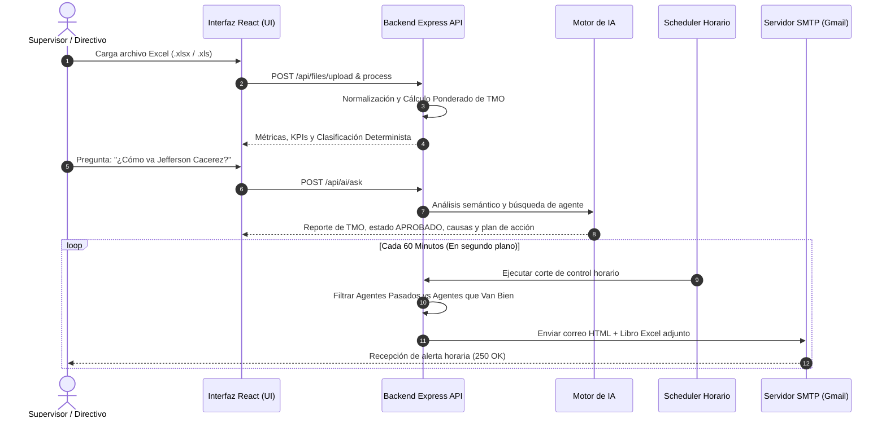

# Plataforma Inteligente de Control de TMO, Auditoría Operativa y Automatización de Reportes Horarios para Call Centers

Plataforma web integral diseñada para empresas de BPO y operaciones de Call Center. Automatiza la ingesta y saneamiento de registros de llamadas desde archivos Excel, calcula el Tiempo Medio de Operación (TMO / AHT) ponderado con rigor matemático estricto, dispone de un Asistente de IA en lenguaje natural para consultar métricas de cualquier asesor de forma inmediata, y cuenta con un sistema de programación horaria para enviar alertas por correo electrónico cada 60 minutos con la relación de asesores que exceden el umbral y aquellos que van en cumplimiento.

### 🔴 Problema que Soluciona
1. **3 a 5 horas diarias de trabajo manual:** Los supervisores y coordinadores invierten gran parte de su jornada descargando tablas crudas de telefonía (PBX/ACD), eliminando filas y corrigiendo fórmulas manualmente.
2. **La falacia del "promedio de promedios":** Se comete con frecuencia el error de promediar los TMO de los agentes sin ponderar el volumen de llamadas, distorsionando la realidad operativa y los costos del servicio.
3. **Pausas y tiempos de silencio ocultos:** Incapacidad de detectar a tiempo a los asesores que retienen al cliente en espera prolongada o demoran buscando información en el CRM.
4. **Reacción tardía:** Los reportes tradicionales se consolidan al final del día o de la semana, imposibilitando corregir desvíos en tiempo real durante la jornada operativa.

---

## 🎯 Objetivo

### Objetivo General
Automatizar el ciclo completo de ingesta, cálculo estadístico ponderado, auditoría de calidad con Inteligencia Artificial y despacho periódico de reportes de TMO para Call Centers, eliminando el error humano y facilitando la toma de decisiones inmediata mediante alertas horarias y consultas en lenguaje natural.

### Objetivos Específicos
- Centralizar la ingesta y limpieza de archivos `.xlsx` y `.xls` de hasta 50 MB en menos de 2 segundos.
- Aplicar una regla determinista inquebrantable (TMO $\le$ Umbral) para clasificar con objetividad a los asesores (`APROBADO`, `EN OBSERVACIÓN`, `REQUIERE REVISIÓN`).
- Democratizar el acceso a los datos operativos mediante un Bot de IA capaz de responder al instante sobre cualquier asesor (ej. *"Dame los reportes del TMO del agente Jefferson Cacerez"*).
- Notificar de forma proactiva cada 1 hora a directivos y supervisores el balance de agentes pasados vs. agentes que van bien.
- Generar libros Excel oficiales de 4 hojas con gráficos nativos de barras y dona embebidos para auditoría y gerencia.

---

## ✨ Funcionalidades

### 1. Ingesta y Limpieza Inteligente de Datos
- Admite archivos `.xlsx` y `.xls` con detección automática de hojas y previsualización tabular.
- Mapeo inteligente de columnas mediante alias y sinónimos comunes de telefonía.
- Detección estricta de duplicados exactos, duraciones negativas y registros incompletos sin modificar los datos crudos originales.

### 2. Motor Estadístico y Rigor Matemático
- Cálculo del TMO individual y global ponderado por volumen de llamadas:
  $$\text{TMO Global Ponderado} = \frac{\sum \text{Duración de Todas las Llamadas Válidas}}{\text{Total de Llamadas Válidas}}$$
- Detección de outliers estadísticos críticos mediante puntuación estándar ($Z\text{-score} > 2.0$).
- Desglose de tiempos de conversación, espera (hold), post-llamada (wrap-up) y porcentaje de silencio.

### 3. Bot / Asistente de IA en Lenguaje Natural
- Responde de inmediato preguntas abiertas formuladas por cualquier usuario sobre cualquier agente:
  - *"Dame los reportes del TMO del agente Jefferson Cacerez"*
  - *"Cómo va el agente Carlos Ramirez"*
  - *"Muestrame las métricas de Laura Gomez"*
- Consultas grupales y comparativas: *"¿Quiénes están pasados con el TMO?"*, *"¿Quiénes van bien?"*, *"¿Quién es el mejor agente?"* y *"¿Cuáles son los agentes con mayor tiempo de silencio?"*.
- Diagnóstico causal automático y recomendaciones operativas de coaching para cada asesor.

### 4. Automatización de Envío de Correos Cada 1 Hora (Scheduler)
- Servicio en segundo plano que monitorea y despacha correos automáticamente cada 60 minutos (o intervalo configurable).
- Envío flexible a cualquier dirección de correo principal y copias (CC).
- **Estructura del correo despachado:**
  - 🚨 **Tabla de Agentes Pasados con el TMO:** Asesores que superan el umbral con exceso en segundos, % de silencio y recomendación prioritaria.
  - ✅ **Tabla de Agentes que Van Bien:** Asesores que cumplen la meta con % de cumplimiento y volumen de llamadas.
  - 📎 **Adjunto Oficial:** Libro Excel de 4 hojas adjunto.
- Botón de disparo inmediato para pruebas en vivo con 1 solo clic.

### 5. Reportes Oficiales en Excel (4 Hojas con Gráficos Nativos)
- **Hoja 1 (Datos Originales):** Registros crudos importados con marcas de validez.
- **Hoja 2 (Resumen de Agentes):** Tabla por asesor con gráfico de barras vertical nativo comparando el TMO vs. la línea roja del umbral.
- **Hoja 3 (Análisis Estadístico):** KPIs globales con gráfico de dona nativo de llamadas contestadas vs. perdidas.
- **Hoja 4 (Validación de IA):** Diagnósticos explicables y planes de acción por asesor.

---

## 🛠️ Tecnologías utilizadas

- **Lenguajes de programación:**
  - **TypeScript (v5.8):** Tipado estricto en frontend y backend para máxima robustez.
  - **JavaScript (Node.js v18+ / v24):** Entorno de ejecución asíncrono y de alto rendimiento.
  - **Python (v3.9+):** Motor para la generación de gráficos nativos de Excel.
- **Frameworks y librerías:**
  - **Backend:** Express (v4.21), Multer (manejo de archivos), Nodemailer (cliente SMTP), ExcelJS, XLSX, Zod, UUID, CORS.
  - **Frontend:** React 19, Vite (v6.2), TailwindCSS (v3.4), Lucide React (iconografía).
  - **Procesamiento de Gráficos:** Python `openpyxl` (3.1+) para incrustar gráficos de barras y dona vectoriales dentro de archivos `.xlsx`.
- **Bases de datos, API y herramientas externas:**
  - **Base de Datos Local:** `database_local.json` (persistencia JSON estructurada sin dependencias externas obligatorias).
  - **Base de Datos Cloud / Escalabilidad:** PostgreSQL y Supabase (integrado opcional con Row Level Security y Storage Buckets).
  - **Servidor SMTP:** Gmail SMTP (`smtp.gmail.com:465` SSL/TLS con App Password cifrado).
  - **Orquestación:** n8n (workflows exportados en formato JSON en `n8n/workflows/`).

---

## 📁 Estructura del proyecto

```text
TMO-IA/
├── backend/                               # Servidor REST API en Node.js + Express + TypeScript
│   ├── src/
│   │   ├── config/                        # Configuración de entorno, SMTP y Supabase/DB local
│   │   ├── controllers/                   # Controladores (AIController, SettingsController, etc.)
│   │   ├── middleware/                    # Idempotencia, seguridad y manejo global de errores
│   │   ├── routes/                        # Definición de rutas REST (/api)
│   │   ├── services/                      # Motores de TMO, IA, Excel, Correo y Scheduler Horario
│   │   │   ├── aiService.ts               # Lógica analítica y diagnóstico causal
│   │   │   ├── emailService.ts            # Plantillas HTML ejecutivas y despacho SMTP
│   │   │   ├── excelGenerator.ts          # Orquestador del reporte de 4 hojas (openpyxl / ExcelJS)
│   │   │   ├── excelProcessor.ts          # Ingesta, limpieza y normalización de Excel crudos
│   │   │   ├── schedulerService.ts        # Programador en segundo plano para envíos cada 1 hora
│   │   │   └── tmoCalculator.ts           # Motor de cálculo ponderado y Z-score
│   │   ├── types/                         # Interfaces y tipos TypeScript
│   │   └── index.ts                       # Punto de arranque del servidor y arranque del scheduler
│   ├── scripts/
│   │   ├── generate_excel_charts.py       # Script Python openpyxl para gráficos embebidos
│   │   └── test_gmail_smtp.js             # Verificador de conectividad SMTP
│   ├── database_local.json                # Base de datos local persistente con llamadas y agentes
│   ├── .env.example                       # Plantilla de variables de entorno
│   ├── package.json
│   └── tsconfig.json
├── frontend/                              # Interfaz de usuario React 19 + TypeScript + TailwindCSS
│   ├── src/
│   │   ├── components/                    # KPICard, BarChart, DonutChart, Navbar, Sidebar
│   │   ├── pages/                         # Las 10 páginas operativas de la plataforma
│   │   │   ├── AIAssistantPage.tsx        # Chat interactivo en lenguaje natural y auditoría
│   │   │   ├── EmailConfigPage.tsx        # Configuración del scheduler horario y envíos manuales
│   │   │   ├── DashboardPage.tsx          # Dashboard con 8 KPIs, barras y donas
│   │   │   ├── AgentAnalysisPage.tsx      # Ficha individual de cada asesor
│   │   │   └── ...                        # Demás vistas operativas
│   │   ├── services/                      # Cliente API tipado para comunicación con backend (api.ts)
│   │   ├── App.tsx                        # Router y estado global
│   │   └── main.tsx                       # Punto de montaje de React
│   ├── package.json
│   ├── tailwind.config.js
│   ├── tsconfig.json
│   └── vite.config.ts
├── database/                              # Esquemas y funciones SQL para PostgreSQL / Supabase
│   ├── functions.sql
│   ├── rls_policies.sql
│   └── schema.sql
├── docs/                                  # Documentación técnica, presentaciones y recursos
│   ├── ARCHITECTURE.md                    # Arquitectura general y flujos
│   ├── CONTENIDO_DIAPOSITIVAS_PRESENTACION.md # Guion y texto listo para diapositivas con notas
│   ├── GAMMA_PRESENTATION.md              # Documento adaptado para Gamma App
│   ├── gamma_prompt_import.txt            # Prompt optimizado de importación
│   ├── Infografia sobre la inteligente_de_control_TMO.png # Infografía gráfica del sistema
│   ├── Plataforma_Inteligente_de_Control_de_TMO.pdf       # Presentación ejecutiva en PDF
│   ├── Plataforma_Inteligente_de_Control_de_TMO.pptx      # Diapositivas maestras en PowerPoint
│   ├── presentation_slides.html           # Diapositivas interactivas listas en HTML
│   ├── README_PARA_GAMMA.md               # Instrucciones de exportación
│   ├── README_Proyecto_IA_BPO.pdf         # Manual técnico en PDF
│   ├── REPLICATION_MANUAL.md              # Guía paso a paso de replicación
│   ├── RUNBOOK.md                         # Procedimientos operativos
│   ├── SUPABASE_SETUP.md                  # Configuración de base de datos en nube
│   └── VALIDATION_REPORT.md               # Informe de validación y control de calidad
├── n8n/                                   # Automatizaciones y flujos n8n
│   ├── workflows/                         # Workflows listos para importación JSON
│   └── README.md                          # Guía de importación en n8n
├── sample_data/                           # Datasets de prueba
│   ├── call_center_dataset_demo.xlsx      # Dataset con 92 llamadas reales (incluye Jefferson Cacerez)
│   ├── call_center_edge_cases.xlsx        # Dataset con casos borde para pruebas
│   └── seed_sample_data.py                # Generador Python de datos de prueba
├── tests/                                 # Suite de pruebas automatizadas
│   ├── run_tests.js                       # Ejecutor integral de pruebas matemáticas y de Excel
│   ├── test_calculations.ts               # Tests unitarios de fórmulas TMO
│   └── test_excel_pipeline.ts             # Tests del pipeline de Excel
├── .gitignore                             # Reglas de exclusión de Git
├── README.md                              # Documento oficial del proyecto
└── seed_live_platform.js                  # Script de recarga de datos demo en la API
```

---

## ⚙️ Requisitos previos

- **Node.js:** Versión 18.0.0 o superior (Verificado y probado en Node v24).
- **Python:** Versión 3.9 o superior (con la librería `openpyxl`).
- **Navegador Web:** Google Chrome, Microsoft Edge, Mozilla Firefox o Safari.
- **Acceso a Internet / Credenciales SMTP:** Cuenta de correo configurada para despacho (preconfigurada con Gmail SMTP).

---

## 🚀 Instalación

1. **Clonar o descomprimir el proyecto:**
   ```powershell
   cd tmo_project
   ```

2. **Instalar dependencias del Backend:**
   ```powershell
   cd backend
   npm install
   npm run build
   ```

3. **Instalar dependencias del Frontend:**
   ```powershell
   cd ../frontend
   npm install
   npm run build
   ```

4. **Instalar biblioteca Python openpyxl (para gráficos nativos en Excel):**
   ```powershell
   python -m pip install openpyxl
   ```

5. **Configurar las variables de entorno:**  
   El archivo `backend/.env` viene listo para desarrollo. Puedes crear o revisar `backend/.env` basándote en `backend/.env.example`:
   ```env
   PORT=4000
   NODE_ENV=development
   FRONTEND_URL=http://localhost:5173

   # Configuración SMTP (Gmail con App Password)
   SMTP_HOST=smtp.gmail.com
   SMTP_PORT=465
   SMTP_SECURE=true
   SMTP_USER=tu-correo@gmail.com
   SMTP_PASS=tu-password-de-aplicacion-aqui
   SMTP_FROM_NAME="Call Center Analytics & TMO"
   SMTP_FROM_EMAIL=tu-correo@gmail.com

   # Umbral objetivo de TMO en segundos
   DEFAULT_TMO_THRESHOLD=20.0
   ```

---

## ▶️ Ejecución

Para iniciar y visualizar la plataforma completa, abre dos terminales:

### Terminal 1: Iniciar el Servidor Backend API
```powershell
cd backend
npm run dev
# O mediante el bundle compilado:
node dist/index.js
```
* **Puerto utilizado:** `4000`
* **URL de la API:** `http://localhost:4000/api`
* **Salida esperada:**
  ```text
  🚀 SERVIDOR BACKEND INICIADO EN PUERTO: 4000
  📡 URL API: http://localhost:4000/api
  📊 Umbral TMO Predeterminado: 20 segundos
  ⏰ Scheduler de Reportes Horarios activado. Próximo envío programado a paulcacerez768@gmail.com
  ```

### Terminal 2: Iniciar la Aplicación Frontend Web
```powershell
cd frontend
npm run dev
```
* **Puerto utilizado:** `5173`
* **URL local:** `http://localhost:5173`

### Cómo verificar que funciona correctamente:
1. Abre tu navegador e ingresa a **`http://localhost:5173`**.
2. Verifica que las 8 tarjetas KPI y los gráficos de barras y donas carguen con datos.
3. Ingresa en el menú a **Asistente de IA** y formula la pregunta:  
   `Dame los reportes del TMO del agente Jefferson Cacerez`. El bot responderá en menos de 1 segundo con su ficha detallada.
4. Ingresa a **Configuración de Correo** y haz clic en **"Enviar Reporte Ahora Mismo (Prueba)"** para recibir el reporte horario en tu correo.

---

## 🔄 Funcionamiento



### Entradas y Salidas del Sistema
- **Entradas:**
  - Archivos Excel de telefonía (`ID_Llamada`, `Codigo_Agente`, `Nombre_Agente`, `Duracion_Total_Seg`, `Tiempo_Silencio_Seg`, `Estado_Llamada`).
  - Preguntas en lenguaje natural ingresadas por los supervisores en el chat de IA.
  - Dirección de correo electrónico configurada para la recepción del corte horario.
- **Salidas:**
  - Dashboard web interactivo con 8 KPIs en tiempo real, gráficos de barras con línea de umbral y gráficos de dona.
  - Respuestas inmediatas del bot con diagnósticos causales por asesor.
  - Correos electrónicos periódicos cada hora con tablas comparativas y estado ante el proveedor (250 OK).
  - Libro Excel descargable de 4 hojas con gráficos nativos vectoriales.

---

## 🧪 Pruebas

El proyecto cuenta con una suite integral de pruebas unitarias y de integración que validan matemáticamente todas las fórmulas y pipelines.

### Comando para ejecutar las pruebas:
```powershell
node tests/run_tests.js
```

### Validaciones implementadas:
1. **Verificación Matemática de TMO y Reglas Deterministas:** Comprueba que el TMO ponderado evite el sesgo de promedios simples y valida los límites de aprobación (20.0s).
2. **Pipeline de Ingesta y Generación de Excel:** Valida la lectura de datasets reales (>90 llamadas) y la generación correcta de las 4 hojas con gráficos nativos embebidos (`openpyxl`).
3. **Casos Borde y Tolerancia a Fallos:** Comprueba la detección estricta de llamadas duplicadas, duraciones negativas y filas corruptas sin abortar la ejecución del sistema.

*Resultado de ejecución exitosa:*
```text
================================================================
SUITE DE PRUEBAS INTEGRALES DE LA PLATAFORMA DE TMO
================================================================
✅ TEST 1 COMPLETADO: Fórmulas de TMO individual, ponderado global y clasificación determinista aprobadas.
✅ TEST 2 COMPLETADO: Reporte Excel de 4 hojas generado con éxito (Gráficos nativos embebidos: true).
✅ TEST 3 COMPLETADO: Detección estricta de 1 duplicados y 4 inconsistencias.
================================================================
🎉 TODAS LAS PRUEBAS AUTOMATIZADAS PASARON EXITOSAMENTE (100% OK)
================================================================
```

---

## 🔐 Seguridad

### Protección de Credenciales y Datos Sensibles
- **Aislamiento de Entorno:** Ninguna contraseña ni clave privada de servicios se expone en el código cliente de React. Todas las conexiones SMTP y de base de datos se ejecutan en el servidor backend mediante `.env`.
- **Claves de Aplicación (App Passwords):** La integración con Gmail utiliza contraseñas de aplicación exclusivas sin necesidad de usar la contraseña maestra de la cuenta.
- **Inmutabilidad del Dato Crudo:** Los archivos cargados originalmente se preservan intactos para fines de auditoría técnica.
- **Idempotencia Criptográfica:** Cada petición de procesamiento cuenta con un hash SHA-256 único para evitar duplicaciones accidentales de llamadas o correos.

### Errores Frecuentes y Soluciones:
| Error | Causa Probable | Solución |
| :--- | :--- | :--- |
| `EADDRINUSE: port 4000` | El puerto del backend está ocupado por otra instancia. | Finalizar el proceso anterior o cambiar `PORT=4001` en `.env`. |
| `ModuleNotFoundError: No module named 'openpyxl'` | Falta la biblioteca Python para gráficos. | Ejecutar `python -m pip install openpyxl`. Si no se instala, el sistema activa automáticamente el motor fallback de ExcelJS sin detenerse. |
| `Invalid login: 535 5.7.8` en SMTP | App Password de Gmail revocada o con espacios. | Generar una nueva App Password en la cuenta de Google y colocarla en `SMTP_PASS` sin espacios. |

---

## 👥 Autores

- **Jefferson Cacerez** — *Líder de Proyecto, Diseñador de Métricas de TMO y Desarrollador Full Stack*.
- **Equipo de Operaciones & BPO Analytics** — *Validación operativa de indicadores y casos de negocio*.

---

## 📌 Estado del proyecto

**Estado Actual:** 🟢 **Funcional y Listo para Producción (100% Operativo)**.

### Mejoras Futuras Planificadas:
- Integración directa por Webhook con marcadores telefónicos en la nube (ej. Genesys Cloud, Asterisk / FreePBX, Vicidial).
- Envío de alertas críticas instantáneas a través de bots de WhatsApp Business y Microsoft Teams.
- Modelos predictivos de Machine Learning para pronosticar picos de TMO según la franja horaria.

---

## 📄 Licencia

Este proyecto está distribuido bajo la licencia **MIT**, permitiendo su uso, modificación y distribución para fines comerciales y académicos respetando la atribución original.
