# Arquitectura del Sistema: Plataforma Inteligente de Análisis de Llamadas, TMO y Automatización

## 1. Visión General de la Arquitectura

La plataforma está diseñada con una arquitectura desacoplada, orientada a microservicios y flujos de automatización basados en eventos. Garantiza alta disponibilidad, idempotencia en el procesamiento de datos, auditoría completa y seguridad en capas.

```mermaid
flowchart TD
    subgraph Frontend["Frontend Web (React + TypeScript + Vite + TailwindCSS)"]
        UI_Dash["Dashboard de KPIs y Gráficos"]
        UI_Upload["Módulo Carga & Preview Excel"]
        UI_Calls["Tabla de Llamadas & Filtros"]
        UI_Agents["Análisis por Agente"]
        UI_Reports["Reportes & Descargas"]
        UI_AI["Asistente de IA"]
        UI_Config["Configuración (Umbral & Correo)"]
        UI_Audit["Historial & Gestión de Errores"]
    end

    subgraph Backend["Backend API (Node.js + Express + TypeScript)"]
        API_Gateway["API Gateway & Middleware de Seguridad"]
        Excel_Parser["Parser de Excel (.xlsx / .xls)"]
        TMO_Engine["Motor de Cálculo Estadístico & TMO"]
        Native_Excel_Gen["Generador de Reportes con Gráficos Nativos"]
        AI_Orchestrator["Orquestador de Asistente IA (Gemini/OpenAI)"]
        Email_Service["Servicio de Correo (SMTP / Resend API)"]
        Idempotency_Guard["Guardia de Idempotencia"]
    end

    subgraph Database["Base de Datos & Storage (PostgreSQL en Supabase)"]
        Auth["Supabase Auth & RLS"]
        DB_Tables[("Tablas Relacionales:
        - uploaded_files
        - agents
        - call_records
        - agent_summaries
        - ai_validations
        - threshold_configs
        - email_logs
        - n8n_executions
        - audit_errors")]
        Storage_Bucket["Supabase Storage Bucket:
        - raw-excels/
        - processed-reports/"]
    end

    subgraph N8N["Automatización de Workflows (n8n Engine)"]
        WF1["Workflow 1: Ingesta, Cálculo & Envío Automático"]
        WF2["Workflow 2: Validación Determinista & Revisión IA (Looping)"]
        WF3["Workflow 3: Auditoría, Manejo de Excepciones & Reintentos"]
    end

    subgraph External_Services["Servicios Externos"]
        SMTP_Server["Servidor SMTP / Email Delivery"]
        LLM_API["API de Inteligencia Artificial"]
    end

    %% Conexiones
    UI_Upload -->|Carga de archivo y Mapeo| API_Gateway
    UI_Dash -->|Consulta de Métricas filtradas| API_Gateway
    UI_AI -->|Consultas y Feedback| API_Gateway
    UI_Config -->|Ajuste de Umbral y Correos| API_Gateway

    API_Gateway --> Excel_Parser
    API_Gateway --> TMO_Engine
    API_Gateway --> Native_Excel_Gen
    API_Gateway --> AI_Orchestrator
    API_Gateway --> Email_Service
    API_Gateway --> Idempotency_Guard

    Backend -->|Lectura / Escritura con RLS y Service Role| DB_Tables
    Backend -->|Almacenamiento seguro de archivos| Storage_Bucket

    API_Gateway -->|Disparo de Workflow con Idempotency Key| WF1
    WF1 -->|Lectura de Excel & Almacenamiento| DB_Tables
    WF1 -->|Envío de reporte por correo| SMTP_Server
    WF1 -->|Disparo de validación| WF2

    WF2 -->|Lectura de resumen de agentes| DB_Tables
    WF2 -->|Procesamiento por lotes / Looping| LLM_API
    WF2 -->|Persistencia de explicaciones y estado| DB_Tables
    WF2 -->|Generación de Excel validado| Storage_Bucket

    WF1 -.->|En caso de error| WF3
    WF2 -.->|En caso de error| WF3
    WF3 -->|Registro de auditoría & reintentos| DB_Tables
```

---

## 2. Principios de Diseño y Patrones Arquitectónicos

### 2.1. Idempotencia y Protección contra Reintentos Duplicados
- Cada archivo cargado genera un hash SHA-256 único de su contenido (`file_hash`) y un identificador UUID (`file_id`).
- Cada ejecución de workflow recibe un `idempotency_key` generado criptográficamente (`hash(file_id + timestamp_slot + workflow_type)`).
- Antes de procesar cualquier fila o enviar un correo, los workflows verifican en la tabla `n8n_executions` si la clave ya está en estado `PROCESSING` o `COMPLETED`. Si existe, se aborta la ejecución redundante devolviendo el estado previo sin duplicar acciones en base de datos ni envíos SMTP.

### 2.2. Aislamiento de Datos Originales vs. Calculados
- Los registros originales importados nunca se modifican: se guardan en la tabla `call_records` conservando los datos crudos, con indicadores de validez (`is_valid`) y motivos de descarte (`validation_errors`).
- Los indicadores agregados se guardan en una tabla independiente (`agent_summaries`) vinculada al `file_id`.
- Las validaciones del asistente inteligente se almacenan en `ai_validations` con referencia a las ejecuciones y agentes, garantizando la trazabilidad histórica de cualquier cambio de umbral.

### 2.3. Jerarquía de Evaluación y Determinismo
- **Prioridad 1 (Regla Determinista Inquebrantable):**
  - Si `TMO <= Umbral_Configurado` (predeterminado 20s): `APROBADO`.
  - Si `TMO > Umbral_Configurado`: `REQUIERE REVISIÓN`.
  - Si `TMO` es nulo, negativo o no calculable: `ERROR DE DATOS`.
- **Prioridad 2 (Análisis Asistido por IA):**
  - La IA no tiene permiso para sobreescribir la etiqueta determinista.
  - La IA aporta: explicación causal, detección de anomalías contextuales (e.g., llamadas de 0s con silencio alto, colas atípicas), detección de agentes atípicos (outliers de más de 2 desviaciones estándar) y recomendaciones operativas.

### 2.4. Generación de Hojas y Gráficos Nativos en Excel
El motor de exportación genera un archivo `.xlsx` estructurado en 4 hojas:
1. **Hoja 1 - Datos Originales:** Datos crudos cargados con metadatos de auditoría.
2. **Hoja 2 - Resumen de Agentes:** Métricas consolidadas, TMO ponderado, porcentaje de cumplimiento y clasificación determinista. Incorpora **Gráfico de Barras vertical nativo** que compara el TMO del agente contra el umbral configurado.
3. **Hoja 3 - Análisis Estadístico:** Totales globales, distribución por rangos de duración y estados de llamadas. Incorpora **Gráfico de Dona nativo** de distribución de estado de llamadas.
4. **Hoja 4 - Validación de IA:** Trazabilidad de la revisión inteligente, justificación, anomalías detectadas y acciones sugeridas.

---

## 3. Formulación Matemática de Indicadores

### 3.1. Tiempo Medio de Operación (TMO / AHT)

Para cada llamada individual con datos completos:
$$\text{Duración de Gestión}_i = \text{Tiempo Conversación}_i + \text{Tiempo Espera}_i + \text{Tiempo Trabajo Posterior}_i$$

Si el archivo solo contiene un campo de duración total de llamada:
$$\text{Duración de Gestión}_i = \text{Duración Registrada}_i$$

Para un agente individual $A$ con $N_A$ llamadas gestionadas válidas:
$$\text{TMO}_A = \frac{\sum_{i=1}^{N_A} \text{Duración de Gestión}_{A,i}}{N_A}$$

### 3.2. TMO Global Consolidado (Evitando Promedio de Promedios)
Dado un conjunto de $K$ agentes, donde el agente $j$ tiene $N_j$ llamadas válidas y un $\text{TMO}_j$:
$$\text{TMO}_{\text{Global}} = \frac{\sum_{j=1}^K (N_j \times \text{TMO}_j)}{\sum_{j=1}^K N_j} = \frac{\sum_{\text{todas las llamadas válidas}} \text{Duración Total}}{\text{Total de Llamadas Válidas}}$$

### 3.3. Porcentaje de Cumplimiento de Umbral

$$\% \text{ Cumplimiento Agente}_A = \frac{\text{Llamadas de } A \text{ con } \text{Duración} \le \text{Umbral}}{N_A} \times 100$$

$$\% \text{ Cumplimiento Global} = \frac{\text{Total de Agentes con } \text{TMO}_A \le \text{Umbral}}{K_{\text{agentes válidos}}} \times 100$$

### 3.4. Detección de Anomalías Estadísticas (Outliers)
Para identificar agentes con tiempos significativamente superiores al grupo:
$$\mu = \frac{1}{K}\sum_{j=1}^K \text{TMO}_j, \quad \sigma = \sqrt{\frac{1}{K}\sum_{j=1}^K (\text{TMO}_j - \mu)^2}$$
$$Z_j = \frac{\text{TMO}_j - \mu}{\sigma}$$
Si $Z_j > 2.0$, el agente es catalogado estadísticamente como un **outlier crítico**.
